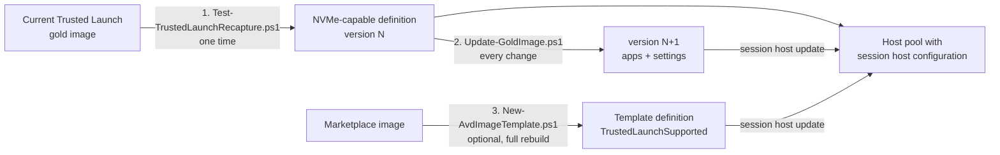

# AVD Image Automation Runbook

PowerShell scripts to build, update and test **Azure Virtual Desktop gold images** without manual VM work,
and to roll new versions out to session hosts with **session host update** instead of rebuilding hosts by hand.

Built and validated end to end in a lab subscription. Every script prints one `PASS` / `FAIL` line per step
and stops at the first failure.

## What problem this solves

A typical AVD environment that grew over time looks like this:

- The gold image is prepared by hand on a VM, then Sysprep'd and captured.
- Session hosts are rebuilt manually every time the image changes, with AD cleanup afterwards.
- Display languages take hours to install and sometimes time out.
- The image cannot move to the newer **NVMe-only** VM sizes (for example Dasv7).
- The image is **Trusted Launch**, so the AVD **Custom Image Template** wizard refuses it as a source.

This repository takes such an environment to the current AVD model:

| Before | After |
|---|---|
| Gold image built by hand | New image version from **one command**: apps installed by script, settings applied, Sysprep, capture, test |
| Hosts rebuilt manually for every change | **Session host update**: one update in the portal, the service drains, rebuilds and re-registers the hosts |
| Image only runs on SCSI sizes | Image definition that supports **SCSI and NVMe**, tested on Dasv7 |
| Language packs time out | **Offline install** from the Microsoft language ISO, about 5 minutes per language |
| No repeatable build | Optional **Custom Image Template** build from the Marketplace image |

> Session host configuration, session host update and dynamic autoscaling were in preview from late 2024 and
> became generally available in mid 2026. Many environments were built before that, on the manual model.

## How it fits together



Three paths, one script each:

| # | Goal | Script | When | Lab time |
|---|---|---|---|---|
| 1 | Move the existing gold image to an NVMe-capable definition and prove it boots on Dasv7 | `Test-TrustedLaunchRecapture.ps1` | Once | 35 to 50 min |
| 2 | Produce the next image version: install apps, apply settings, capture, test | `Update-GoldImage.ps1` | Every image change | about 27 min |
| 3 | Rebuild the image from scratch with Azure VM Image Builder | `New-AvdImageTemplate.ps1` | Optional, long term | about 90 min |

Each new version is rolled out the same way: *Host pool > Session host configuration > Update*.

## Prerequisites

- PowerShell 7 (Windows Terminal, VS Code or Azure Cloud Shell). Avoid PowerShell ISE: it turns informational
  Azure CLI messages into errors and stops the scripts.
- Azure CLI, signed in with `az login`, and the right subscription selected (`az account set`).
- Contributor on the resource group that holds the Compute Gallery.
- A subnet for the temporary VMs. Lab default: a temporary VNet with a NAT gateway. No VM ever gets a public IP;
  everything inside the VMs runs through Azure Run Command.
- An admin password for the temporary VMs: 12+ characters with 3 of lower case, upper case, number, special.

```powershell
git clone https://github.com/renatocamara/avd-image-automation-runbook
cd avd-image-automation-runbook
$pw = Read-Host -AsSecureString "Admin password for the temporary VMs"
```

## 1. Move the existing gold image to NVMe (once)

Creates a new gallery definition with `SecurityType = TrustedLaunch` and `DiskControllerTypes = SCSI, NVMe`,
captures the current gold image into it, and boots a test VM on `Standard_D4as_v7`.

```powershell
$src = az sig image-version show -g <image-rg> --gallery-name <gallery> `
    --gallery-image-definition <current-definition> --gallery-image-version <version> --query id -o tsv

.\Test-TrustedLaunchRecapture.ps1 -AdminPassword $pw -ResourceGroup <image-rg> -Location <region> `
    -GalleryName <gallery> -ImageDefinition <new-nvme-definition> -ImageVersion 2026.1.0 `
    -SourceImageVersionId $src -SubnetId <subnet-id> -SkipExperiment
```

| Checkpoint | Proves |
|---|---|
| A | The Trusted Launch image is captured into the NVMe-capable definition |
| B | A VM from the new version deploys on Dasv7 with Trusted Launch |
| C | Inside that VM: NVMe controller, Secure Boot, vTPM, installed languages |

Alternative source: `-SourceVmName <vm>` captures an existing, running, not Sysprep'd VM (a snapshot of its
OS disk is taken first). Without `-SourceImageVersionId` or `-SourceVmName`, the script runs as a lab test
from the Marketplace image.

Then create (or update) the host pool with **session host configuration** pointing to this version.

## 2. New image version in one command (every change)

```powershell
.\Update-GoldImage.ps1 -AdminPassword $pw -ResourceGroup <image-rg> -Location <region> -GalleryName <gallery> `
    -ImageDefinition <nvme-definition> -NewVersion 2026.2.0 -SubnetId <subnet-id> `
    -Apps 7zip -EnableTimeZoneRedirection
```

What it does:

1. Finds the latest version in the definition (or `-FromVersion`).
2. Creates a temporary build VM from it: Trusted Launch, no public IP, not domain joined.
3. Installs each application listed in `-Apps`, from its manifest.
4. Applies optional settings: `-EnableTimeZoneRedirection`, `-FSLogixVhdLocation \\<account>.file.core.windows.net\<share>`.
5. Waits for Windows servicing to be idle, runs Sysprep and captures `-NewVersion`.
6. Boots a test VM from the **new** version on Dasv7, checks NVMe, Secure Boot, vTPM, and that every application
   and setting is really in the image. Deletes the test VM.

Each run starts from the latest version, so pass only what changes in that run. When it prints
`NEW GOLD IMAGE READY`, roll it out with session host update and delete the build VM (the command is printed).

### Adding an application

One folder per application under `apps/`, with an `app.json`:

```json
{
  "name": "7-Zip",
  "installer": "7z2409-x64.msi",
  "downloadUrl": "https://www.7-zip.org/a/7z2409-x64.msi",
  "install": "msiexec.exe /i \"{installer}\" /qn /norestart",
  "validate": "C:\\Program Files\\7-Zip\\7z.exe",
  "version": "24.09"
}
```

- `install`: silent install command; `{installer}` is replaced with the downloaded file path.
- `validate`: a file that exists only when the install succeeded.
- `version` (optional): expected product or file version of the `validate` file, checked as a prefix (`24.09`
  matches `24.09.0.0`). Use it when updating an application that is already in the image: without it, the check
  only proves the file exists, which the old version already satisfies.
- Exit code `3010` (reboot required) counts as success. Before Sysprep the script restarts the build VM when an
  installer returned 3010 or Windows reports a pending reboot.
- Installers come from `downloadUrl`, or from your own storage account with
  `-StorageAccount <account> -Container <container>` (blob path `<container>/<app>/<installer>`).
  In storage mode the script creates a read-only, 3-hour user delegation SAS: no account keys, no identity on
  the VM. You need *Storage Blob Data Reader* on the account, and the build VM needs a network path to it.

To publish a folder of vendor installers in one step, `Publish-AppInstallers.ps1 -SourcePath <folder>
-StorageAccount <account> -Container <container>` uploads each file to its own folder with a simple name
(`<app>/setup.exe`, no spaces), reads the version from the file name, and creates a starting `app.json` per
application; only the silent switch and the `validate` path are left to fill in.

Applications that change every few weeks are often better delivered with **AVD App Attach** than baked into the
image; keep the image for the OS, languages, prerequisites and stable apps.

### App Attach package from the same app.json

`New-AppAttachPackage.ps1` builds an App Attach package for one application of the `apps` folder, entirely through
Run Command on a clean Windows 11 packaging VM (no RDP): it installs the application from the installers container,
copies its folder into an MSIX layout with the application's own icon and a desktop shortcut, signs the package,
converts it to CimFS with `msixmgr` and copies the files to the App Attach share.

```powershell
.\New-AppAttachPackage.ps1 -ResourceGroup <image-rg> -VmName <packaging-vm> -App <app> `
    -StorageAccount <installers-account> -Container <container> -PackageName <Vendor.App> `
    -Publisher "CN=<signing certificate subject>" -Version <app version, four parts> `
    -ShareResourceGroup <share-rg> -ShareStorageAccount <share-account> -ShareName <share> `
    -TimestampUrl http://timestamp.digicert.com
```

- `validate` in `app.json` must point to the program file: its folder is what gets packaged.
- The first run creates a self-signed certificate on the packaging VM and saves the public part as
  `appattach-signing.cer`; session hosts must trust it (*Local Machine > Trusted People*), in the gold image for
  production. Prefer a code signing certificate from your PKI with the same subject.
- `-TimestampUrl` keeps signatures valid after the certificate expires. `-NoDesktopShortcut` skips the shortcut.
- Keep the package version equal to the application version; a new release is a new `.cim` next to the current one,
  switched in *Azure Virtual Desktop > App attach*.

## 3. Full rebuild with a Custom Image Template (optional)

Starts from the Windows 11 multi-session Marketplace image, installs applications by script, adds display
languages offline, runs Windows Update and Sysprep, and publishes to the gallery. The template shows up under
*Azure Virtual Desktop > Custom image templates*.

```powershell
.\New-AvdImageTemplate.ps1 -SubscriptionId <sub> -ResourceGroup <image-rg> -Location <region> `
    -GalleryName <gallery> -SubnetId <subnet-id> -StagingResourceGroup <empty-staging-rg> `
    -ScriptBaseUrl https://raw.githubusercontent.com/renatocamara/avd-image-automation-runbook/main
# follow a running build
.\New-AvdImageTemplate.ps1 -ResourceGroup <image-rg> -MonitorOnly
```

It creates a managed identity with a narrow custom role, a `TrustedLaunchSupported` + `SCSI, NVMe` definition
(the only security type Image Builder can write to; VMs from it still run with Trusted Launch), and the template.
Languages: `-Languages de-DE,fr-FR,zh-CN`. Apps: `-Apps 7zip` (same `app.json` format as above).

Before the first build, check the subscription for policies that disable **shared key** or **public network
access** on storage accounts: they break Image Builder's staging storage. See
[docs/findings.md](docs/findings.md#azure-policy-and-image-builder-staging-storage).

To validate the customizer scripts on a plain VM in about 30 minutes, without Image Builder:
`Test-CustomizersOnVm.ps1`.

## Repository layout

```
Test-TrustedLaunchRecapture.ps1   1. capture an existing gold image into an NVMe-capable definition, test on Dasv7
Update-GoldImage.ps1              2. new image version: apps + settings + capture + test, one command
Publish-AppInstallers.ps1         upload a folder of installers to the container and create starting app.json files
New-AppAttachPackage.ps1          App Attach package (signed MSIX + CimFS) for one app, built on a packaging VM
New-AvdImageTemplate.ps1          3. Custom Image Template (Azure VM Image Builder) build
Test-CustomizersOnVm.ps1          run the template customizers on a plain VM, for quick validation
customizers/                      scripts that run inside the image (languages, apps, Sysprep cleanup)
apps/<name>/app.json              one manifest per application
docs/findings.md                  platform limitations found, fixes and measured times
```

## Cleanup (lab)

```powershell
az group delete -n rg-avd-img-test-lab --yes --no-wait
```

## Further reading

- [Findings, fixes and measured times](docs/findings.md)
- [Session host update](https://learn.microsoft.com/azure/virtual-desktop/session-host-update)
- [Custom image templates](https://learn.microsoft.com/azure/virtual-desktop/custom-image-templates)
- [Language packs for Windows 11 in AVD](https://learn.microsoft.com/azure/virtual-desktop/windows-11-language-packs)
- [Image Builder and Trusted Launch](https://learn.microsoft.com/azure/virtual-machines/image-builder-overview#confidential-vm-and-trusted-launch-support)
